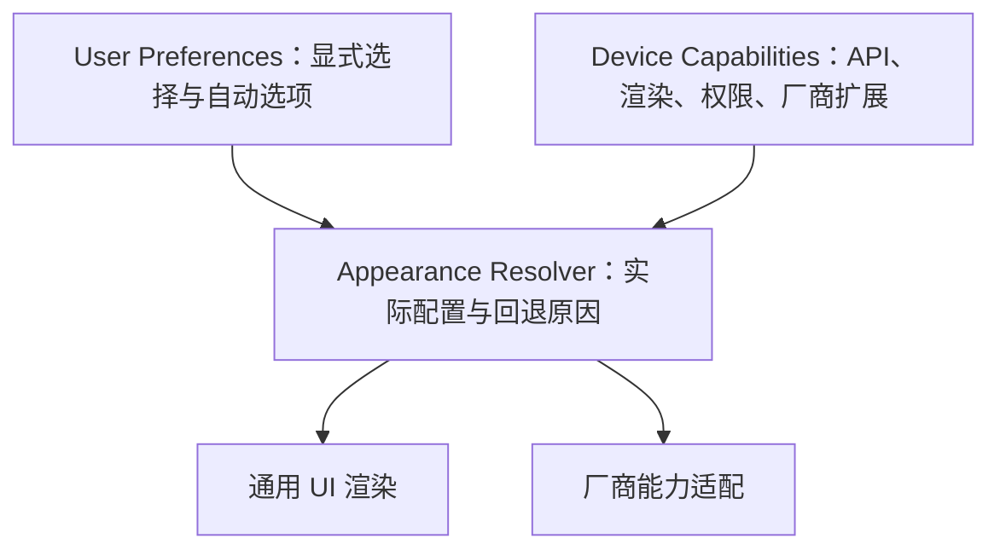

# 偏好、能力与适配策略

在系统自动适配与用户自定义需要共存时，采用以下职责关系。按实际规模使用函数、模块或已有类，不强制新增五个物理层。

## 分开意图、能力与实际配置

- User Preferences 保存用户明确选择以及 Auto／跟随系统，不保存设备临时回退后的值覆盖原选择。迁移已有项目时保留默认值、标识和即时生效语义；没有获授权时不增加设置入口。
- Device Capabilities 由外层适配器取得实际 API、硬件／软件渲染、权限、系统服务和厂商扩展状态。把未知与明确不可用分开；品牌名只能帮助定位，不能单独证明能力。避免在业务规则和各控件中重复探测系统。
- Appearance Resolver 接收偏好和能力，输出当前可执行配置及明确回退原因；输入可替换时尽量成为可独立验证的策略。能力是执行边界，不能由用户强选绕过；能力恢复后重新解析原偏好，不要求重新设置。
- 通用渲染器消费实际配置；厂商适配器隔离 SDK、Intent、生命周期和系统模板。标准 API 映射到厂商外壳时仍按标准接入记录，不凭产品名称认定为私有调用。通知／桌面等由系统管理的表面不能承诺与应用内渲染完全一致。
- 调度、网络、存储等非视觉能力使用各自的执行策略；不要为了套用图示把它们塞入 Appearance Resolver。

## 区分能力与执行结果

权限允许、渠道可用、符合格式和实际发布／提升是不同状态。预检不能证明最终可见；发布后也只能记录取得的实际证据。背景任务被接受不等于已经执行；用户期望的间隔与系统允许的执行时点分别表达，不承诺未知的准点保证。

对业务提交后的可选表面逐个隔离预期的发布异常，继续交付同一修订的快照。记录失败供诊断，不覆盖领域成功／失败或更新时间，不因通知失败重跑已成功查询。账户失效和过期结果检查保持在发布前。不要捕获全部 Throwable 来掩盖核心缺陷；必须成功的副作用使用其自身事务、确认或重试契约，不能按可选发布静默跳过。

将阈值回升、去重解锁等状态更新与平台发布资格分开，避免渠道关闭使业务恢复路径停滞。先完成身份／代次准备，再发布新实例；旧实例清理失败的重试按身份或 ID 跟踪，成功替换后移出旧清理集合，不能撤掉本代次的新内容。

## 动态能力与降级生命周期

能力可能随省电、窗口、权限、渲染目标或系统服务变化。只缓存有效期内的探测结果；需要监听时随实际 owner 注册／移除，并隔离离场或旧代次的迟到回调。

降级路径保持文字、命中范围、内容身份和可读性；关闭失效的高级效果时清理录制状态、绘制栈、节点、监听和动画。选择有界重试或明确恢复条件，避免每帧重试和重复日志。不要把同一设备正常路径的效果改成最低档，也不要建立没有消费者的全局能力框架。

## 用反例验证边界

按受影响范围选择：显式选择与 Auto；支持／不支持／未知；权限或渠道被关闭；能力运行中消失再恢复；高级渲染失败而文字仍清晰；一个发布器失败而其余表面仍消费同一修订；detach 后迟到回调；账户切换后旧结果不发布。验证过程中检查偏好字节和默认值未被回退改写。

把源码依赖、可控替身、系统运行及 OEM 真机证据分别记录。模拟能力变化和构建通过不能替代实际后台时点、系统模板或 GPU 表现。
